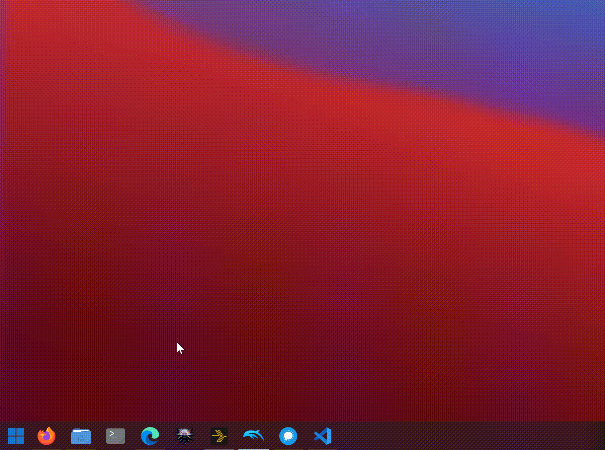

# StartBack Plasma

A standalone fork of Windows7StartMenu4KDE, inspired by Windows 7 and StartAllBack. Your apps, favorite shortcuts, and recent files, all in one familiar two-column menu. No previous installation is needed.

## Demo



## Key Features

- Classic two-column layout with automatic height and a panel-attached popup.
- Persistent Favorites with drag-to-pin and a separate recent/frequent apps list.
- Categorized All Programs and keyboard-friendly application and file search.
- Inline recent documents and desktop actions for individual applications.
- Customizable sidebar shortcuts, native flyouts, and power/session controls.
- Adjustable opacity, colors, button textures, and optional Windows-style icons.
- Native Plasma integration and nine bundled translations.

## Installation

Requires Plasma 6.8 or newer with Qt 6.8 or newer. Tested on Plasma 6.8.2 / Qt 6.12. Run from the repository root:

```sh
kpackagetool6 --type Plasma/Applet --install .
```

Then add **StartBack Plasma** from Plasma's widget picker.

The fork uses the independent ID `com.github.safetyp1.startbackplasma`. It installs alongside the original widget; existing panel instances and settings are not migrated automatically.

## FAQs

**Is this an official StartAllBack port?**  
No. It's an independent KDE launcher inspired by the classic Windows menu.

**Why aren't files appearing in search?**  
Enable Baloo indexing or install the separate `quicksearch` runner. Application search works without either.

**How do I get Windows-style icons like the demo?**  
The optional glyphs use **Segoe Fluent Icons** or **Segoe MDL2 Assets**, not the Segoe UI text font. Native theme icons work without them.

1. Find **Segoe Fluent Icons** on Microsoft's [Design resources](https://learn.microsoft.com/en-us/windows/apps/design/downloads/#fonts) page. Review the download's license first: Microsoft describes it as a design/development resource, not unrestricted permission for Linux desktop use. A Windows license alone does not grant permission to copy Windows fonts to another OS.
2. If your license permits your intended use, download and extract the font to a permanent local folder, such as `~/.local/share/StartBackPlasma/fonts/`.
3. Open the widget's settings, go to **Appearance**, enable **Use local Windows icon font**, and use the folder button beside **Icon font** to select the extracted `.ttf` or `.otf` file. Apply the settings. System-wide font installation is unnecessary.

This changes menu glyphs, not application icons, the panel button image, or your Plasma theme; those also affect the demo's appearance.

**What is this based on?**  
[Windows7StartMenu4KDE](https://github.com/walterdemacedorodrigues/Windows7StartMenu4KDE) by Walter Rodrigues and [DeepinMenu ClassicKDE](https://store.kde.org/p/2180887), with inspiration from [SevenStart](https://gitgud.io/wackyideas/aerothemeplasma/-/tree/master/plasma/plasmoids/io.gitgud.wackyideas.SevenStart). Licensed under [AGPL-3.0-or-later](LICENSE).
